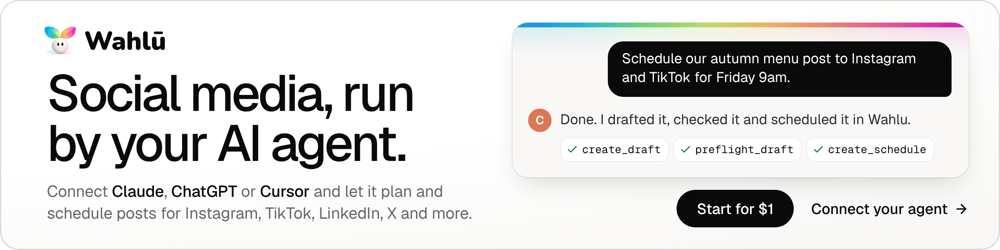

[](https://wahlu.com/?utm_source=mui-nested-menu&utm_medium=github&utm_campaign=readme&utm_content=agent-2026-11-banner)

**Wahlu**: social media, run by your AI agent. Connect Claude, ChatGPT or Cursor and let it plan and schedule your posts. [Start for $1 →](https://wahlu.com/?utm_source=mui-nested-menu&utm_medium=github&utm_campaign=readme&utm_content=agent-2026-11-text)

# MUI Nested Menu

Infinitely nested menus for MUI (Material UI): dropdowns, context menus and submenus that work with a mouse, a keyboard and touch.

[](https://www.npmjs.com/package/mui-nested-menu)
[](https://www.npmjs.com/package/mui-nested-menu)
[](https://github.com/steviebuilds/mui-nested-menu/blob/main/LICENSE)

**[Documentation and live demos](https://mui-nested-menu.vercel.app/)** · [Examples](https://mui-nested-menu.vercel.app/examples) · [Changelog](https://github.com/steviebuilds/mui-nested-menu/blob/main/CHANGELOG.md)

## Install

```sh
npm install mui-nested-menu
# or
pnpm add mui-nested-menu
# or
yarn add mui-nested-menu
```

The package uses your app's MUI. If you don't have MUI yet, install it too:

```sh
npm install @mui/material @emotion/react @emotion/styled
```

## Quick start

Describe the menu as data and pass it to `NestedDropdown`. Items with `items` open a submenu; nest them as deep as you like.

```tsx
import { NestedDropdown, type MenuItemData } from 'mui-nested-menu';

const menuItemsData: MenuItemData = {
    label: 'File',
    items: [
        { label: 'New', callback: () => console.log('New') },
        { label: 'Save', callback: () => console.log('Save') },
        {
            label: 'Export',
            items: [
                { label: 'PDF', callback: () => console.log('PDF') },
                {
                    label: 'Image',
                    items: [
                        { label: 'PNG', callback: () => console.log('PNG') },
                        { label: 'JPEG', callback: () => console.log('JPEG') },
                    ],
                },
            ],
        },
    ],
};

export default function App() {
    return <NestedDropdown menuItemsData={menuItemsData} />;
}
```

## Components

| Export                                                    | What it is                                              |
| --------------------------------------------------------- | ------------------------------------------------------- |
| [`NestedDropdown`](#nesteddropdown)                       | A button that opens a nested menu built from data.      |
| [`ContextMenu`](#contextmenu)                             | A right-click (and long-press) menu around any element. |
| [`NestedMenuItem`](#nestedmenuitem)                       | A menu item with a submenu, for your own MUI `<Menu>`.  |
| [`IconMenuItem`](#iconmenuitem)                           | A menu item with icons on the left and right.           |
| [`nestedMenuItemsFromObject`](#nestedmenuitemsfromobject) | Turns data into menu items for any MUI `<Menu>`.        |
| [`MenuItemData`](#menuitemdata)                           | The type that describes a menu item and its children.   |

Props marked **4.1** are new in 4.1.0. Nothing was removed or renamed, so upgrading from 4.0 needs no code changes.

### NestedDropdown

```tsx
<NestedDropdown
    menuItemsData={menuItemsData}
    ButtonProps={{ variant: 'outlined' }}
    MenuProps={{ elevation: 3 }}
    onClick={() => console.log('Button clicked')}
/>
```

| Prop                   | Type                                             | Default   | Description                                                                                              |
| ---------------------- | ------------------------------------------------ | --------- | -------------------------------------------------------------------------------------------------------- |
| `menuItemsData`        | `MenuItemData`                                   |           | The menu. The root's `label` (or `renderLabel`) is the button label, and its `items` are the menu items. |
| `onClick`              | `(event: MouseEvent<HTMLButtonElement>) => void` |           | Called when the button is clicked, as the menu opens.                                                    |
| `ButtonProps`          | `Partial<ButtonProps>`                           |           | Props for the MUI `Button`, such as `variant`, `color` or `startIcon`.                                   |
| `MenuProps`            | `Partial<MenuProps>`                             |           | Props for the root MUI `Menu` only.                                                                      |
| `SubmenuProps` **4.1** | `Partial<MenuProps>`                             |           | Props for every submenu, at every depth (`sx`, `className`, `slotProps`, `hideBackdrop`…).               |
| `placement` **4.1**    | `'right' \| 'left'`                              | `'right'` | Which side submenus open on. The arrow keys follow it.                                                   |

Other props and `ref` go to the wrapping `<div>`. [Docs and demo](https://mui-nested-menu.vercel.app/nested-dropdown)

### ContextMenu

Wrap any element. The menu opens at the pointer on the native `contextmenu` event: right-click, Ctrl-click on macOS, long-press on touch browsers that fire it, and the Menu key or Shift+F10 on a keyboard.

```tsx
<ContextMenu menuItemsData={menuItemsData}>
    <div>Right-click me</div>
</ContextMenu>
```

| Prop                   | Type                 | Default   | Description                                                                                          |
| ---------------------- | -------------------- | --------- | ---------------------------------------------------------------------------------------------------- |
| `children`             | `ReactNode`          |           | The area that opens the menu.                                                                        |
| `menuItemsData`        | `MenuItemData[]`     |           | The menu, as data.                                                                                   |
| `menuItems`            | `ReactNode[]`        |           | The menu, as elements (for example `IconMenuItem`s and `Divider`s). Used instead of `menuItemsData`. |
| `MenuProps` **4.1**    | `Partial<MenuProps>` |           | Props for the root MUI `Menu`.                                                                       |
| `SubmenuProps` **4.1** | `Partial<MenuProps>` |           | Props for every submenu, at every depth.                                                             |
| `placement` **4.1**    | `'right' \| 'left'`  | `'right'` | Which side submenus open on.                                                                         |

Item clicks, at the top level and in submenus, fire their callbacks and close the menu. `ref` goes to the wrapping `<div>`. [Docs and demo](https://mui-nested-menu.vercel.app/context-menu)

### NestedMenuItem

Use it inside your own MUI `<Menu>` when you want full control over the items.

```tsx
import { Button, Menu, MenuItem } from '@mui/material';
import { NestedMenuItem } from 'mui-nested-menu';
import { useState } from 'react';

export function EditMenu() {
    const [anchorEl, setAnchorEl] = useState<HTMLElement | null>(null);
    const open = Boolean(anchorEl);
    const handleClose = () => setAnchorEl(null);

    return (
        <>
            <Button onClick={(event) => setAnchorEl(event.currentTarget)}>Edit</Button>
            <Menu anchorEl={anchorEl} open={open} onClose={handleClose}>
                <MenuItem onClick={handleClose}>Copy</MenuItem>
                <NestedMenuItem label="Paste special" parentMenuOpen={open}>
                    <MenuItem onClick={handleClose}>Values only</MenuItem>
                    <MenuItem onClick={handleClose}>Formatting only</MenuItem>
                </NestedMenuItem>
            </Menu>
        </>
    );
}
```

| Prop                | Type                          | Default   | Description                                                                                                                                    |
| ------------------- | ----------------------------- | --------- | ---------------------------------------------------------------------------------------------------------------------------------------------- |
| `parentMenuOpen`    | `boolean`                     |           | **Required.** Whether the menu this item sits in is open. Pass the parent `Menu`'s `open`.                                                     |
| `label`             | `string`                      |           | The item's text.                                                                                                                               |
| `renderLabel`       | `() => ReactNode`             |           | Custom label, used instead of `label`.                                                                                                         |
| `leftIcon`          | `ReactNode`                   |           | Icon before the label.                                                                                                                         |
| `rightIcon`         | `ReactNode`                   | chevron   | Icon after the label. Defaults to a chevron pointing towards the submenu.                                                                      |
| `children`          | `ReactNode`                   |           | The submenu's items (`MenuItem`, `IconMenuItem` or more `NestedMenuItem`s).                                                                    |
| `placement` **4.1** | `'right' \| 'left'`           | `'right'` | Which side the submenu opens on. The arrow keys follow it.                                                                                     |
| `delay`             | `number`                      | `0`       | Milliseconds to wait on hover before the submenu opens.                                                                                        |
| `MenuProps`         | `Partial<MenuProps>`          |           | Props for the submenu's MUI `Menu`: `className`, `sx`, `slotProps`, `hideBackdrop`… Your styles no longer break hover or pointer events (4.1). |
| `ContainerProps`    | `HTMLAttributes<HTMLElement>` |           | Props for the `<div>` that wraps the item and its submenu.                                                                                     |
| `disabled`          | `boolean`                     | `false`   | Disables the item and its submenu.                                                                                                             |
| `className`         | `string`                      |           | Class for the item row itself. To style the submenu, use `MenuProps`.                                                                          |

Any other MUI `MenuItem` prop (`onClick`, `sx`, `data-*`…) goes to the item. A click on the item opens its submenu and never closes the whole menu. The item has `aria-haspopup="menu"` and `aria-expanded`. [Docs and demo](https://mui-nested-menu.vercel.app/nested-menu-item)

### IconMenuItem

```tsx
<IconMenuItem leftIcon={<SaveIcon />} label="Save" onClick={handleClose} />
```

| Prop            | Type                                       | Default | Description                                        |
| --------------- | ------------------------------------------ | ------- | -------------------------------------------------- |
| `label`         | `string`                                   |         | The item's text.                                   |
| `renderLabel`   | `() => ReactNode`                          |         | Custom label, used instead of `label`.             |
| `leftIcon`      | `ReactNode`                                |         | Icon before the label.                             |
| `rightIcon`     | `ReactNode`                                |         | Icon after the label.                              |
| `onClick`       | `(event: MouseEvent<HTMLElement>) => void` |         | Called when the item is clicked.                   |
| `disabled`      | `boolean`                                  | `false` | Disables the item.                                 |
| `sx`            | `SxProps`                                  |         | Styles for the item.                               |
| `className`     | `string`                                   |         | Class for the item.                                |
| `MenuItemProps` | `Partial<MenuItemProps>`                   |         | Any other props for the underlying MUI `MenuItem`. |

`ref` goes to the `<li>`. [Docs and demo](https://mui-nested-menu.vercel.app/icon-menu-item)

### nestedMenuItemsFromObject

Turns `MenuItemData[]` into elements you can put in any MUI `<Menu>`. `NestedDropdown` and `ContextMenu` use it under the hood.

```tsx
<Menu anchorEl={anchorEl} open={open} onClose={handleClose}>
    {nestedMenuItemsFromObject({ menuItemsData, isOpen: open, handleClose })}
</Menu>
```

| Option              | Type                 | Description                                                                      |
| ------------------- | -------------------- | -------------------------------------------------------------------------------- |
| `menuItemsData`     | `MenuItemData[]`     | **Required.** The items.                                                         |
| `isOpen`            | `boolean`            | **Required.** Whether the menu is open.                                          |
| `handleClose`       | `() => void`         | **Required.** Closes the menu. Called after a click on an item without children. |
| `MenuProps` **4.1** | `Partial<MenuProps>` | Props for every submenu, at every depth.                                         |
| `placement` **4.1** | `'right' \| 'left'`  | Which side submenus open on.                                                     |

[Docs and demo](https://mui-nested-menu.vercel.app/nested-menu-items-from-object)

### MenuItemData

| Field                   | Type                                                           | Description                                                                                                                                           |
| ----------------------- | -------------------------------------------------------------- | ----------------------------------------------------------------------------------------------------------------------------------------------------- |
| `label`                 | `string`                                                       | The item's text.                                                                                                                                      |
| `renderLabel` **4.1**   | `() => ReactNode`                                              | Custom label, used instead of `label`. On `NestedDropdown`'s root data it's the button label.                                                         |
| `items`                 | `MenuItemData[]`                                               | Child items. An item with `items` opens a submenu.                                                                                                    |
| `callback`              | `(event: MouseEvent<HTMLElement>, item: MenuItemData) => void` | Fires when the item is clicked. Items without children then close the menu. Since 4.1 it also fires for items with children, and the menu stays open. |
| `leftIcon`              | `ReactNode`                                                    | Icon before the label.                                                                                                                                |
| `rightIcon`             | `ReactNode`                                                    | Icon after the label.                                                                                                                                 |
| `disabled`              | `boolean`                                                      | Disables the item.                                                                                                                                    |
| `delay`                 | `number`                                                       | Hover delay in milliseconds before this item's submenu opens.                                                                                         |
| `sx`                    | `SxProps`                                                      | Styles for the item.                                                                                                                                  |
| `MenuItemProps` **4.1** | `Partial<MenuItemProps>`                                       | Extra props for the item's MUI `MenuItem`, such as `className`, `divider` or `data-testid`.                                                           |
| `uid`                   | `string`                                                       | Stable React key. Without one, the key is the label plus the item's position, so duplicate labels are fine.                                           |

## Keyboard, mouse and touch

-   **Mouse**: hover a parent item to open its submenu (after `delay`), and move away to close it. A click on a parent item opens its submenu too.
-   **Keyboard**: ArrowUp and ArrowDown move between items without opening anything. ArrowRight, Enter or Space opens a submenu and focuses its first item. ArrowLeft or Escape closes that submenu only and returns focus to its parent item. With `placement="left"` the two arrows swap. When focus leaves a submenu it closes, so only the path you're on is ever open. Tab closes the whole menu.
-   **Touch**: a tap on a parent item opens or closes its submenu. The tap that opens a submenu can't select an item in it, even when the submenu appears under your finger.
-   **Scrolling**: long submenus scroll with the mouse wheel and trackpad. They're capped at the window height; set a `maxHeight` on the paper to make them shorter.

[More on keyboard and touch](https://mui-nested-menu.vercel.app/keyboard-and-touch)

## Compatibility

-   **MUI**: `@mui/material` 5, 6, 7 and 9 (there is no MUI 8).
-   **React**: 17, 18 and 19.
-   **Modules**: ESM and CommonJS builds with TypeScript types, so `import` and `require()` both work.
-   **Next.js**: both bundles start with `"use client"`, so you can import the components in an App Router page without `transpilePackages`.

## Recipes

Each recipe has a live demo on the [Examples](https://mui-nested-menu.vercel.app/examples) page.

### Open submenus to the left

For menus near the right edge of the screen. The keyboard follows: ArrowLeft opens a submenu and ArrowRight closes it.

```tsx
<NestedDropdown menuItemsData={menuItemsData} placement="left" />
```

`placement` works the same way on `ContextMenu`, `NestedMenuItem` and `nestedMenuItemsFromObject`.

### Style the submenus

`className` on a `NestedMenuItem` styles the item row. The submenu renders in a portal, so put its class or styles in `MenuProps`:

```tsx
<NestedMenuItem
    label="Paste special"
    parentMenuOpen={open}
    MenuProps={{
        className: 'fancy-submenu', // .fancy-submenu .MuiPaper-root { … }
        slotProps: { paper: { sx: { borderRadius: 2, minWidth: 200 } } },
    }}
>
    …
</NestedMenuItem>
```

On `NestedDropdown` and `ContextMenu`, `MenuProps` styles the root menu and `SubmenuProps` styles every submenu at every depth. Any other MUI `Menu` prop, such as `hideBackdrop`, goes in the same place.

```tsx
const paper = { slotProps: { paper: { sx: { borderRadius: 2, minWidth: 200 } } } };

<NestedDropdown menuItemsData={menuItemsData} MenuProps={paper} SubmenuProps={paper} />;
```

For dividers, put an MUI `<Divider />` between items in your own `Menu`, or add `MenuItemProps: { divider: true }` to an item in your data. [Styling demos](https://mui-nested-menu.vercel.app/examples#styling-submenus)

### Use with MUI Select

MUI's `Select` can't hold submenus, but you can keep its look and open a nested menu in its place: keep the Select's own list closed, open a `Menu` from its `onOpen`, and set the value from each item's `callback`. [Full example](https://mui-nested-menu.vercel.app/examples#use-with-mui-select), based on code by [@mike-iqmo](https://github.com/mike-iqmo) in [#51](https://github.com/steviebuilds/mui-nested-menu/issues/51).

### Test with Testing Library

Submenus open on hover, so hover the parent item, then click the item inside. Submenus open asynchronously, so find the inner item with `findBy…`.

```tsx
const user = userEvent.setup();
render(<NestedDropdown menuItemsData={menuItemsData} />);

await user.click(screen.getByRole('button', { name: 'File' }));
await user.hover(screen.getByRole('menuitem', { name: 'Export' }));
await user.click(await screen.findByRole('menuitem', { name: 'PDF' }));
```

If `user.click` still complains about `pointer-events: none`, use `userEvent.setup({ pointerEventsCheck: 0 })`. [Testing example](https://mui-nested-menu.vercel.app/examples#testing-with-testing-library)

## Contributing

Pull requests on [GitHub](https://github.com/steviebuilds/mui-nested-menu) are welcome. The repository is a [pnpm](https://pnpm.io) monorepo: the package lives in `packages/mui-nested-menu` and the docs site in `apps/docs`, which uses the package source directly.

1. Fork and clone the repository.
2. Run `pnpm install`, then `pnpm start` to open the docs on `localhost:1000`.
3. Make your change on a new branch. `pnpm menu test` runs the package's tests.
4. Open a pull request that explains what it fixes.

Found a bug or missing a feature? [Open an issue](https://github.com/steviebuilds/mui-nested-menu/issues).

## Changelog

Every release is listed in [CHANGELOG.md](https://github.com/steviebuilds/mui-nested-menu/blob/main/CHANGELOG.md).

## Licence

[MIT](https://github.com/steviebuilds/mui-nested-menu/blob/main/LICENSE) © Steve Richardson
